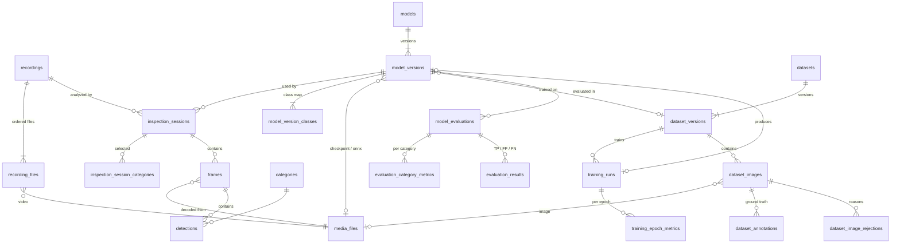

# Database and media storage

DINOS keeps its metadata (models, datasets, inspection sessions, detections)
in **PostgreSQL 18** and its files (videos, images, model weights, exports) in
a **media folder** on local disk. The database stores only paths relative to
that folder, so the folder can move to another drive, or be restored from a
backup, by changing one setting.

All storage code lives in `app/storage/`:

For create/read service contracts and SCRUM-48 acceptance tests, see
[Storage services](storage-services.md).

| File | Purpose |
|---|---|
| `config.py` | Loads `DINOS_*` settings from the environment or `.env` |
| `database.py` | Engines, sessions, and actionable connection errors |
| `models.py` | SQLAlchemy models, the single definition of the schema |
| `migrations/` | Alembic migrations generated from `models.py` |
| `schema.py` | Run migrations and check the schema version from Python |
| `media.py` | Save and read files beneath the media root |
| `__main__.py` | `python -m app.storage migrate` and `check` |

## Quick start (developers)

Requires Python 3.12 and Docker (OrbStack or Docker Desktop on macOS, Docker
Desktop on Windows). Every developer gets their own local database; git
holds the instructions for building it (`models.py`, the migrations,
`docker-compose.yml`), never the data or the `.env` file.

macOS / Linux:

```bash
python3.12 -m venv .venv && source .venv/bin/activate
pip install -r requirements.txt
cp .env.example .env            # set DINOS_DB_PASSWORD to any long random value
docker compose up -d            # PostgreSQL 18 on localhost:5432
python -m app.storage migrate   # create the tables (safe to run again)
python -m app.storage check     # verify settings, connection, schema, media folder
QT_QPA_PLATFORM=offscreen python -m pytest -q
```

Windows (PowerShell):

```powershell
py -3.12 -m venv .venv; .venv\Scripts\Activate.ps1
pip install -r requirements.txt
Copy-Item .env.example .env     # set DINOS_DB_PASSWORD to any long random value
docker compose up -d
python -m app.storage migrate
python -m app.storage check
$env:QT_QPA_PLATFORM = "offscreen"; python -m pytest -q
```

After pulling a teammate's schema change, run `python -m app.storage migrate`
again; it applies only the new migrations. `docker compose down` stops the
server and keeps your data. `docker compose down -v` deletes it.

To browse the tables, connect any PostgreSQL client to `localhost:5432`,
database `dinos`, user `dinos`, with the password from `.env`: pgAdmin 4
(installed with PostgreSQL on Windows), DBeaver Community (can draw an ER
diagram from the live schema), TablePlus, or the PostgreSQL extension for
VS Code. From a terminal:
`docker compose exec postgres psql -U dinos -d dinos -c '\dt'`.

## Installing on the Windows PC

1. Install **PostgreSQL 18** with the official installer from
   postgresql.org (EDB). Keep the default port 5432 and remember the
   `postgres` superuser password. StackBuilder is not needed.
2. Open **SQL Shell (psql)** as `postgres` and create the app's user and
   database. The built-in `C.UTF-8` collation makes sorting match the
   developers' machines exactly:

   ```sql
   CREATE ROLE dinos LOGIN PASSWORD 'choose-a-long-random-password';
   CREATE DATABASE dinos OWNER dinos TEMPLATE template0 ENCODING 'UTF8'
       LOCALE_PROVIDER builtin BUILTIN_LOCALE 'C.UTF-8';
   ```

3. Create `.env` next to the app (copy `.env.example`), set the password
   from step 2, and point `DINOS_MEDIA_ROOT` at a folder on a large drive,
   for example `D:\DINOS\media`.
4. Run `python -m app.storage migrate`, then `python -m app.storage check`.
5. Keep the database local-only. In `postgresql.conf` set
   `listen_addresses = 'localhost'`, and make sure `pg_hba.conf` only has
   `127.0.0.1/32` and `::1/128` host lines. Restart the
   `postgresql-x64-18` service after changing either file.
6. Optional but recommended: add Windows Defender exclusions for the media
   folder and the PostgreSQL data folder. Scanning large video files as
   they are written slows uploads and analysis significantly.

## Configuration

Settings come from the process environment first, then from the `.env`
file (`DINOS_ENV_FILE` overrides its location). `.env` is ignored by git.
Never commit credentials.

| Variable | Required | Example | Notes |
|---|---|---|---|
| `DINOS_DB_HOST` | yes | `localhost` | |
| `DINOS_DB_PORT` | no | `5432` | Defaults to 5432 |
| `DINOS_DB_NAME` | yes | `dinos` | |
| `DINOS_DB_USER` | yes | `dinos` | |
| `DINOS_DB_PASSWORD` | yes | | Special characters are fine; no quoting needed |
| `DINOS_MEDIA_ROOT` | yes | `./data/media`, `D:\DINOS\media` | Relative paths resolve against the `.env` file's folder |

## Design decisions

### Uploaded video, sampled at 1 frame per second

Recorded video files are uploaded into the app and copied into the media
folder unchanged (no re-encoding or splitting; a recording can hold several
files if the camera writes hourly chunks). Analysis samples one frame per
second, as in the mockup. An 8-hour shift is then about 28,800 frame rows
and roughly 600,000 detection rows, which PostgreSQL handles easily.
Analyzing every frame would multiply that by the camera's frame rate and
count the same almond many times. Totals are therefore per-frame
detections, not unique objects; counting unique objects would need tracking
(a `track_id` on detections) later.

### Store the video once; store annotations as rows

Frames point at the video file plus a frame number and timestamp, and
detections are rows on the frame. Annotated images are never saved: the app
decodes the frame and draws the boxes when displaying or exporting it.
Saving a JPEG per frame would duplicate the video's pixels (8 hours of
1080p video is already roughly 20-50 GB), bake one model's boxes into the
image so re-analysis is impossible, and create millions of small files that
slow Windows backups and antivirus scans. Because frames are found by
seeking, the timestamp is stored alongside the frame number.

### Recordings are separate from inspection sessions

A recording is the footage; a session is one analysis of it with one model
version, interval, sampling rate, threshold, and category selection. The
mockup's "Change Model" re-analyzes the same footage, so one recording has
many sessions and the video is never copied.

### PostgreSQL 18

PostgreSQL is free for commercial use under the permissive PostgreSQL
License. It has no LTS releases; each major version is supported for five
years, and 18 is supported until November 2030. We chose 18 (rather than 19,
still a release candidate at the time) for its year of bug-fix releases,
its built-in `uuidv7()`, and its built-in `C.UTF-8` collation, which sorts
text identically on macOS, Linux, and Windows.

### SQLAlchemy, Alembic, and psycopg

SQLAlchemy models are the single definition of the schema, Alembic manages
versioned migrations, and psycopg 3 is the driver. Compared with
hand-written SQL, this gives typed models with autocomplete for the team,
a test that fails if the schema and migrations drift apart, and a
maintained migration tool instead of one we would write ourselves. The
trade-off is a learning curve (sessions, lazy loading); hot paths such as
saving detections should use bulk Core inserts rather than ORM objects.

Migrations matter even for one PC: every teammate already has a database,
and the schema will keep changing with new features. `migrate` upgrades
each copy in place without losing data, records which version it is at,
and the app refuses to start against a mismatched database. After
delivery, the same command updates the client's PC, or several factory
sites, without losing inspection history. New almond varieties or defect
types are new rows (datasets, models, categories), not schema changes.

SQLAlchemy and Alembic are MIT licensed. psycopg is LGPL-3.0 and used
unmodified as a Python import, the same obligations PySide6 already brings;
if the app is ever bundled with PyInstaller, use one-folder mode and
include the license texts.

### Models: RF-DETR, run as ONNX

Models are trained with RF-DETR (its Apache 2.0 sizes: Nano, Small, Medium,
Large) and exported to ONNX for inference with onnxruntime (MIT). That is
why a model version stores two files: the native checkpoint for
fine-tuning and the ONNX export for inference. The app and database do not
depend on the training framework, so it can change later without schema
changes.

### Labels: COCO JSON

Datasets import from COCO instances files, which `app/dataset/records.py`
and RF-DETR already use. Inside the database, boxes are normalized corners
(see Conventions) and exporters convert back to COCO when training.

### Tables now, features later

The schema already covers the charter's login, training, dataset
management, and model evaluation features so they can be built without
reshaping data. What each needs when it is built:

| Feature | Needs |
|---|---|
| Login | Argon2id password hashing (`argon2-cffi`) in `users.password_hash`, roles (operator, engineer, admin), and, for remote use, the API service described under "Future: remote access" |
| Training | A worker process separate from the UI that updates `training_runs`; the UI requests a stop with `stopping` and the worker stops between batches after saving a checkpoint; runs left `running` after a crash are marked `failed` on startup |
| Dataset import | A COCO importer that validates images and labels, and frozen dataset versions so training stays reproducible |
| Evaluation | A job on the same worker setup using a standard metrics library; compare only evaluations on the same dataset version, split, and thresholds |

## Schema



Every table also has `created_at`; user-created records have a nullable
`created_by` pointing at `users`.

### Inspection

- **recordings** are uploaded footage from one camera and line, for example
  an 8-hour shift. A recording owns one or more **recording_files** in
  order (cameras often split a shift into hourly files), each placed at a
  `start_offset_ms`. An uploaded snapshot is a recording with one image.
- **inspection_sessions** are one analysis of a recording with one
  **model version**, interval (`interval_start_ms` to `interval_end_ms`),
  cadence (`sample_fps`, 1.0 = one frame per second), confidence
  threshold, and selected categories. Re-running with another model creates
  another session against the same footage; the video is never copied.
- **frames** are the analyzed frames of a session, including frames with no
  detections, so "analyzed, nothing found" differs from "never analyzed".
  `frame_index` is the decoded frame number inside the media file (NULL for
  still images) and `timestamp_ms` is the offset from the recording start.
  The pair `(session, media_file, frame_index)` is unique, so an interrupted
  analysis can resume without duplicates.
- **detections** are predicted boxes on a frame. Totals are per-frame
  detections, not unique objects; tracking objects across frames would add
  a `track_id` later.
- Annotated images are **not stored**. To display or export a frame, decode
  it from the video and draw its detections. At 1 fps an 8-hour session is
  about 28,800 frame rows and roughly 600,000 detection rows.

### Models

- **models** group **model_versions** (e.g. `almond-sort` v4). A version
  records its architecture (`rf-detr-medium`), framework (`rfdetr`), input
  size, and weights: `checkpoint_media_file_id` for the native RF-DETR
  `.pth` (resume/fine-tune) and `onnx_media_file_id` for the ONNX export the
  app runs with onnxruntime. At least one is required.
- **model_version_classes** maps each output class index to a category.
- `training_dataset_version_id` is set when the training data is known (NULL
  for imported models). `training_run_id` links the run that produced it.

### Datasets

- **datasets** have **dataset_versions** that mirror the saved manifests in
  `app/dataset/manifest.py` (label, content hash, schema version, lot and
  session requirements). Mark a version `frozen` once a model is trained on
  it, and never change a frozen version; create a new version instead.
- **dataset_images** hold accepted and rejected images (mirroring
  `AcceptedImage` / `RejectedImage` in `app/dataset/records.py`), with split
  (`train` / `valid` / `test`, matching `split_dataset` and RF-DETR),
  source lot and session, and near-duplicate group. Rejected images keep
  their reasons in **dataset_image_rejections** and never get a split.
- **dataset_annotations** are ground-truth boxes.

### Training and evaluation

- **training_runs** track status (`queued`, `running`, `stopping`,
  `completed`, `stopped`, `failed`), settings (`config` JSON), and progress.
  The UI requests a safe stop by setting `stopping`; the training worker
  checks it between batches, saves a checkpoint, and sets `stopped`.
  **training_epoch_metrics** store the learning curves.
- **model_evaluations** store metrics for one model version on one split of
  one dataset version at fixed IoU and confidence thresholds. Only compare
  evaluations whose dataset version, split, and thresholds match.
  **evaluation_category_metrics** hold per-category results, and
  **evaluation_results** hold each true positive, false positive, and false
  negative for reviewing mistakes.

### Conventions

- **IDs.** Top-level records use UUIDv7 generated by PostgreSQL: they sort
  by creation time and stay unique across machines, which keeps backup,
  restore, and a future multi-machine setup safe. High-volume rows use
  bigint identities; `categories` uses smallint.
- **Bounding boxes** are normalized corners, `0 <= x_min < x_max <= 1` (same
  for y), relative to the image or frame. The database rejects invalid
  boxes. Convert to COCO pixels with `x = x_min * width`,
  `w = (x_max - x_min) * width`, and so on.
- **Timestamps** are `timestamptz` in UTC. Convert to local time only for
  display (on Windows, Python's `zoneinfo` needs the `tzdata` package, which
  is already in `requirements.txt`).
- **Statuses and kinds** are text with CHECK constraints, not PostgreSQL
  enum types, so adding a value is a one-line migration.
- **Deletes.** Detail rows (frames, detections, annotations, metrics)
  cascade from their parent. Anything that records provenance restricts
  deletion: you cannot delete a model version used by a session, a media
  file still referenced, or a dataset version used for training.
- **Constraints** enforce required fields, value ranges, and consistent
  states (for example a `failed` run must have an `error_message`, and a
  `completed` session must have `finished_at`).

## Using it from code

```python
from app.storage.config import load_settings
from app.storage.database import create_db_engine, check_connection, session_factory
from app.storage.media import MediaStore, add_media_file, media_path
from app.storage.models import MediaKind, Recording, RecordingFile
from app.storage.schema import ensure_schema_current

settings = load_settings()
engine = create_db_engine(settings.database)
check_connection(engine, settings.database)  # DatabaseConnectionError with next steps
ensure_schema_current(engine)                 # SchemaVersionError if not migrated
store = MediaStore.open(settings.media_root)  # MediaStorageError if not writable
Session = session_factory(engine)

with Session.begin() as session:
    video = add_media_file(session, store, "C:/uploads/shift.mp4", MediaKind.VIDEO,
                           width=1280, height=720, fps=30.0)
    session.add(Recording(name="Morning inspection", files=[
        RecordingFile(position=0, media_file=video),
    ]))

path = media_path(store, video)  # absolute path, or MediaMissingError
```

All storage errors subclass `app.storage.errors.StorageError` and carry a
message that can be shown to the user as-is.

## Changing the schema

1. Edit `app/storage/models.py`.
2. Draft a migration against your local database:
   `alembic revision --autogenerate -m "add tracking ids"`.
3. Review the generated file in `app/storage/migrations/versions/`.
   Autogenerate misses renames and data changes, and cannot order
   circular foreign keys (see how `0001` adds
   `fk_model_versions_training_run_id` after both tables exist).
4. Run `python -m app.storage migrate` and the tests. A test fails if the
   models and migrations disagree.
5. Never edit a migration that has been merged to `main`; add a new one.

`migrate` is safe to run on every start: it applies only missing migrations
and never deletes or duplicates rows. Concurrent runs (two app windows) are
serialized with a PostgreSQL advisory lock.

## Tests

`pytest` runs the storage tests against throwaway `dinos_test_*` databases
on the server in `.env`, migrated fresh and dropped afterwards. Your
development data is never touched. Without a reachable server those tests
are skipped (see `pytest -rs`); set `DINOS_REQUIRE_DB=1` to make that a
failure, as CI should.

## Developing on macOS, running on Windows

| Area | Difference | How the code handles it |
|---|---|---|
| Text sorting | Windows locales sort differently | Databases use the built-in `C.UTF-8` collation everywhere |
| File names | Windows rejects `:` and names like `CON`, ignores case, and limits paths to 260 characters | Stored names are random hex plus a short extension under short folders |
| Paths | `\` vs `/` | The database stores `/`-separated relative paths; `pathlib` converts |
| Open files | Windows cannot rename or delete a file another program has open | Saves write a `.partial` file and rename it into place |
| Text encoding | Windows defaults to cp1252 | Files are read and written as UTF-8 explicitly |
| Backups | `pg_dump` must be the same major version as the server or newer | Use the tools installed with PostgreSQL 18 |
| GPU | Macs have no CUDA, and the team workstation has an AMD GPU | Inference runs ONNX models; verify speed on the actual Windows PC |

Before a demo, run `python -m app.storage check` and the test suite on the
Windows PC itself.

## Future: remote access

Today the app, PostgreSQL, and the media folder share one Windows PC, and
PostgreSQL only accepts local connections. To let factory-floor tablets or
remote laptops in later:

```
Tablet / laptop --VPN--> Windows PC
                          |- API service (e.g. FastAPI): HTTPS, login, roles
                          |- PostgreSQL (still localhost only)
                          '- media folder (served only through the API)
```

Do **not** open PostgreSQL to the network: every client would then hold the
database password and could bypass the app's login, and remote clients
still could not read the media files. Instead, an API service on the
Windows PC owns the database and files, clients authenticate to it, and the
client's existing VPN (or WireGuard) carries the traffic.

The current design keeps that move small:

- All storage access goes through `app/storage`, which moves behind the API
  unchanged. Keep UI code free of SQL and file paths.
- The database stores relative media paths, so the API can serve files by
  ID.
- UUID keys, the `users` table (`password_hash` for Argon2id, `role`), and
  `created_by` columns are already in place.
- Settings come only from the environment or `.env`.
